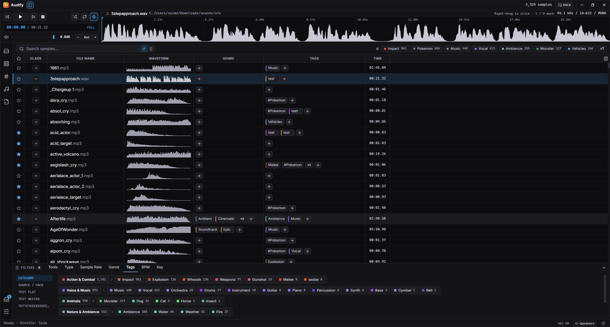
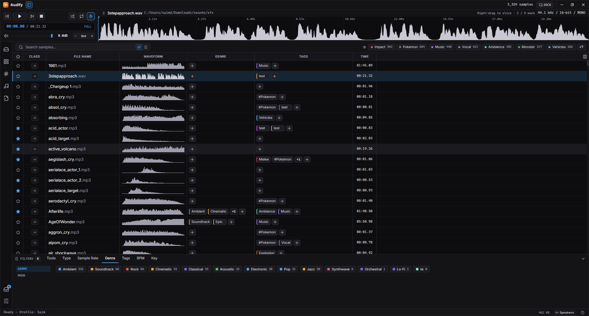
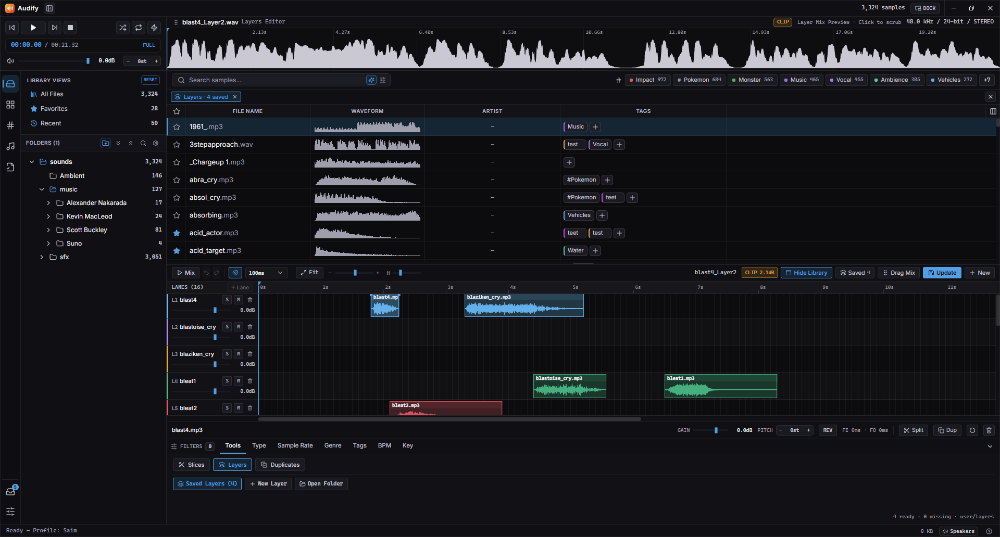
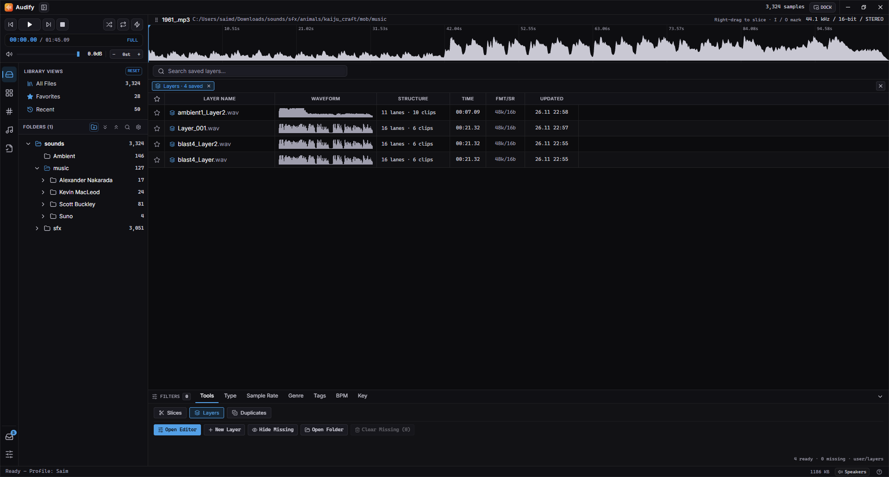
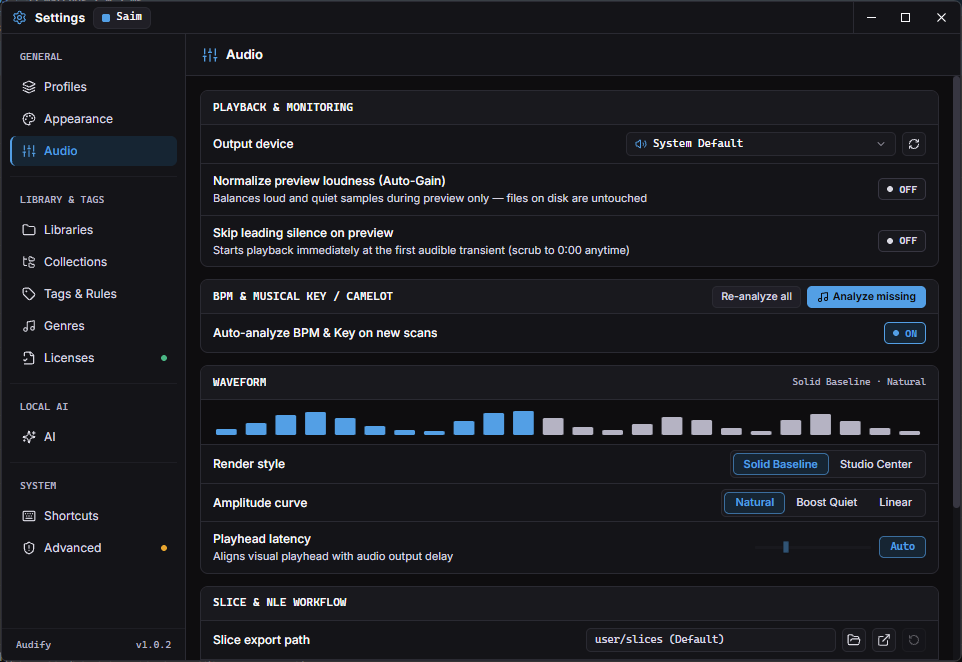

<div align="center">
  

  <h1>Audify</h1>

  <p>
    <strong>Fast, offline-first, portable audio sample, SFX &amp; music library manager</strong><br />
    Built for video editors (NLEs), sound designers, and music producers (DAWs).
  </p>

  <p>
    
    
    
    
    
  </p>

  <p>
    <a href="#-screenshots">Screenshots</a> &bull;
    <a href="#-at-a-glance">At a Glance</a> &bull;
    <a href="#-core-features">Features</a> &bull;
    <a href="#-smart-search--shortcuts">Search &amp; Shortcuts</a> &bull;
    <a href="#-privacy--portability">Privacy</a> &bull;
    <a href="#-getting-started">Build Locally</a>
  </p>

  <br />

  <picture>
    <source media="(prefers-color-scheme: dark)" srcset="docs/assets/images/Dark%20Theme.png" />
    <source media="(prefers-color-scheme: light)" srcset="docs/assets/images/Light%20Theme.png" />
    
  </picture>
</div>

---

**Audify** manages **50,000+ to 100,000+ audio files** with low memory usage, instant search, real-time waveform slicing, and native drag-and-drop straight into **DaVinci Resolve, Premiere Pro, Reaper, Ableton Live, FL Studio, Logic Pro, and Pro Tools** — all in a single portable desktop app with zero accounts or cloud lock-in.

---

## ✨ At a Glance

| Pillar | What You Get |
| :--- | :--- |
| ⚡ **Built for Massive Libraries** | 60 FPS virtualized browser across 100k+ tracks with `.wav`, `.mp3`, `.flac`, `.ogg`, `.aif`, `.aiff`, `.m4a`, `.opus`, and `.aac` support |
| 🎛️ **Native Audio & Slicing** | Low-latency Rust playback, varispeed pitch (`-12` to `+12 st`), waveform `In`/`Out` slicing, and direct drag-to-timeline |
| 🎚️ **Layers SFX Timeline** | Built-in multi-track timeline editor to stack clips across lanes, tweak gain/pitch/reverse/fades, preview live mixes, and save or drag directly to your NLE |
| 🏷️ **Deep Taxonomy & Rules** | Hierarchical faceted Tags, Genres & Moods, automatic parent-hue color harmony, and Auto-Tag Rules with live preview & Undo |
| 🧠 **100% Offline AI & DSP** | Multi-threaded Rust BPM & Camelot key detection, optional local YAMNet auto-tagging, 128-D acoustic similarity, and k-NN tag learning |
| 🎨 **Customizable Studio UI** | Dark, Light & High Contrast modes, Windows Mica glass, Mini Dock companion mode, and 108 built-in procedural ASCII backdrops |

---

## 📸 Screenshots

### Themes & Atmospheric Backdrops

<table>
  <tr>
    <td align="center" width="50%">
      <br />
      <sub><strong>Dark Theme</strong> — Low-glare studio default</sub>
    </td>
    <td align="center" width="50%">
      <br />
      <sub><strong>Light Theme</strong> — Crisp daylight contrast</sub>
    </td>
  </tr>
  <tr>
    <td align="center" width="50%">
      <br />
      <sub><strong>High Contrast Theme</strong> — Pure black &amp; sharp borders</sub>
    </td>
    <td align="center" width="50%">
      <br />
      <sub><strong>ASCII Backdrop</strong> — 108 built-in procedural scenes &amp; ASCII Magic</sub>
    </td>
  </tr>
</table>

### Filtering, Taxonomy & Offline AI Similarity

<table>
  <tr>
    <td align="center" width="50%">
      <br />
      <sub><strong>Faceted Tags &amp; Filters</strong> — Hierarchical tag families &amp; resizable drawer</sub>
    </td>
    <td align="center" width="50%">
      <br />
      <sub><strong>Genres &amp; Moods</strong> — Dedicated music &amp; mood taxonomy</sub>
    </td>
  </tr>
  <tr>
    <td align="center" width="50%">
      <br />
      <sub><strong>Tools Drawer</strong> — Instant access to Slices, Layers &amp; Duplicate Finder</sub>
    </td>
    <td align="center" width="50%">
      <br />
      <sub><strong>Similarity Search</strong> — Find acoustically similar sounds offline (<code>Shift+Enter</code>)</sub>
    </td>
  </tr>
</table>

### Layers — Multi-Track SFX Timeline Editor

<table>
  <tr>
    <td align="center" width="50%">
      <br />
      <sub><strong>Layers Timeline Editor</strong> — Stack clips with waveforms, lane Solo/Mute/Gain, clip Pitch/Reverse/Split &amp; Drag Mix</sub>
    </td>
    <td align="center" width="50%">
      <br />
      <sub><strong>Saved Layers Vault</strong> — Browse, replay &amp; reopen rendered composite mixes saved in <code>user/layers</code></sub>
    </td>
  </tr>
</table>

### Mini Dock Edge-Peek, Compact Layout & Settings Studio

<table>
  <tr>
    <td align="center" width="50%">
      <br />
      <sub><strong>Mini Dock Edge-Peek</strong> — Discreet screen-edge tab beside your NLE/DAW</sub>
    </td>
    <td align="center" width="50%">
      <br />
      <sub><strong>Mini Dock Expanded</strong> — Audition, filter &amp; drag straight to timeline</sub>
    </td>
  </tr>
  <tr>
    <td align="center" width="50%">
      <br />
      <sub><strong>Collapsed Sidebar</strong> — Maximum horizontal space for waveforms &amp; metadata</sub>
    </td>
    <td align="center" width="50%">
      <br />
      <sub><strong>Settings Studio</strong> — Profiles, Libraries, Tags &amp; Rules, Genres, AI &amp; Shortcuts</sub>
    </td>
  </tr>
</table>

---

## 🚀 Core Features

### 🎧 Playback, Slicing & NLE / DAW Bridge

- **High-Density Sample Browser & Native Audio Engine**
  Scroll massive catalogs at 60 FPS with customizable, resizable, and reorderable columns (inline mini waveforms, BPM, Camelot key, genre, tags, format, and dates). Powered by a low-latency native Rust audio engine featuring varispeed pitch shifting, loop & shuffle modes, leading-silence skipping, and loudness normalization.
- **Interactive Waveform Deck & Slices Manager**
  Zoom and scrub on a high-resolution waveform with draggable `In` / `Out` region handles. Drag any track, pitched sample, or selected region straight onto an NLE or DAW timeline to export a clean, micro-faded WAV slice automatically. Browse, replay, favorite, rename, or jump back to the source of exported clips in the dedicated **Slices** view.
- **Layers — Multi-Track SFX Timeline Editor**
  Design composite sound effects right inside Audify without opening a full DAW. Drag library samples onto color-coded timeline lanes with snap grid, lane **Solo / Mute / Gain**, marquee selection, and per-clip **Gain, Pitch, Reverse (`REV`), Fade In/Out, Split (`S`), and Duplicate** controls. Audition the combined result in real time with the top-deck **Layer Mix Preview** & clipping indicator, drag the rendered mix straight into your NLE (**Drag Mix**), or save and reopen editable mixes inside your portable `user/layers` folder.
- **Mini Dock Companion Mode (`Ctrl+M`)**
  Collapse Audify into a compact, always-on-top floating strip beside your full-screen video editor or DAW — complete with optional screen-edge auto-peek, search, resizable filters drawer, mini waveforms, transport controls, and direct drag-to-timeline.

### 🔍 Search, Filtering & Organization

- **Smart Search & Resizable Filters Drawer**
  Combine free-text queries with structured studio operators, live autocomplete, and bilingual English/Turkish SFX synonym expansion. The resizable bottom **Filters Drawer** (`Tools`, `Type`, `Sample Rate`, `Genre`, `Tags`, `BPM`, `Key`) features clean faceted navigation, `ALL`/`ANY` matching, and `Alt+Click` exclusions.
- **Faceted Tags, Genres & Auto-Tag Rules**
  Organize sounds using up to 3-level nested **Tags** (`Category`, `Source / Pack`, plus custom nested or flat facets) and **Genres & Moods** (including sub-genres & custom facets). Reorder and reparent via drag-and-drop, keep sibling colors unified with automatic parent-hue shading, tag rows instantly with `T` / `G`, and automate classification with keyword/duration/folder **Auto-Tag Rules** featuring live impact previews and 1-click Undo.
- **Collections & Smart Collections**
  Build nested manual **Collections** with optional auto-subfolder templates and automatic drag routing, or save any Smart Search query as a dynamic **Smart Collection** that stays up to date automatically.

### 🧰 Studio Productivity & Library Hygiene

- **Session Bin**
  Stage tracks from across folders, searches, and collections into a lightweight project scratchpad — with optional auto-add whenever you drag clips to an NLE/DAW — then copy paths or license credits in one action.
- **Duplicate Finder**
  Detect redundant files across a single library or your whole profile using **Exact Hash** (byte-identical clones) or **Similar Audio** (acoustic/waveform near-duplicates with adjustable similarity thresholds), backed by smart keep suggestions and read-only library protection.
- **File Operations & Non-Destructive Trash Vault**
  Manage files directly on disk with the **Batch Rename Studio** (`F2`), physical folder actions, and optional **Read-Only Library** locks. Deleted samples and slices move to a managed **Trash Vault** with atomic Undo/Redo (`Ctrl+Z` / `Ctrl+Y`) that restores all tags, genres, favorites, and collections intact.
- **Licenses & Attribution Credits**
  Map libraries or subfolders to license tiers (*CC-BY 4.0*, *Epidemic*, *Artlist*, *Custom*) using tokenized attribution templates (`{title}`, `{artist}`, `{file_name}`, `{folder}`), and press `Ctrl+Shift+C` to copy formatted credits for selected tracks or your Session Bin.

### 🧠 Offline AI, Workspaces & Visual Customization

- **Local Offline AI & DSP Analysis**
  Run multi-threaded Rust DSP for offline **BPM** and **Musical / Camelot Key** detection. Optionally download the local **YAMNet ONNX** model for 100% offline AI auto-tagging, **128-D acoustic similarity search** (`Shift+Enter`), and **k-NN custom tag learning** trained purely on your own manually tagged library.
- **Profiles, Live Sync & Portable Backups**
  Keep isolated workspaces for different workflows (*Film SFX*, *Music Production*, *Client Projects*) with separate libraries, favorites, collections, rules, shortcuts, and themes. Includes live folder watching, automatic drive-letter relinking, share-safe `.audify-profile` packages, and one-click `.audify-backup.zip` full snapshots.
- **Appearance, Themes & Backdrops**
  Switch cleanly between **Dark**, **Light**, and **High Contrast** modes with customizable accent colors (manual or auto-extracted from your wallpaper) and Windows **Mica** frosted glass tinting. Personalize the workspace with custom images, videos, GIFs, **108 built-in procedural ASCII scenes**, or the sandboxed **ASCII Magic** catalog.

---

## ⌨️ Smart Search & Shortcuts

<table>
  <tr>
    <td valign="top" width="52%">
      <strong>Smart Search Operators</strong>
      <br /><br />
      <table>
        <thead>
          <tr><th>Operator</th><th>Example</th></tr>
        </thead>
        <tbody>
          <tr><td>Duration</td><td><code>&lt;2s</code>, <code>&gt;10s</code>, <code>dur:1-5s</code></td></tr>
          <tr><td>Tempo (BPM)</td><td><code>bpm:120</code>, <code>bpm:90-130</code></td></tr>
          <tr><td>Key &amp; Harmonic</td><td><code>key:Am</code>, <code>key:8A</code>, <code>key:~8A</code></td></tr>
          <tr><td>Taxonomy</td><td><code>tag:impact</code>, <code>genre:electronic</code>, <code>mood:dark</code></td></tr>
          <tr><td>Artist</td><td><code>artist:"Kevin MacLeod"</code>, <code>artist:"Alexander Nakarada"</code></td></tr>
          <tr><td>Custom Facets</td><td><code>source:pack</code>, <code>material:steel</code></td></tr>
          <tr><td>State &amp; Exclude</td><td><code>is:fav</code>, <code>is:loop</code>, <code>-tag:ui</code>, <code>ext:wav</code></td></tr>
        </tbody>
      </table>
    </td>
    <td valign="top" width="48%">
      <strong>Essential Shortcuts</strong> <em>(fully customizable)</em>
      <br /><br />
      <table>
        <thead>
          <tr><th>Shortcut</th><th>Action</th></tr>
        </thead>
        <tbody>
          <tr><td><code>Space</code></td><td>Play / Pause</td></tr>
          <tr><td><code>T</code> / <code>G</code></td><td>Quick Tag / Genre &amp; Mood Picker</td></tr>
          <tr><td><code>Shift+Enter</code></td><td>Find Acoustically Similar Sounds</td></tr>
          <tr><td><code>Ctrl+M</code></td><td>Toggle Mini Dock Companion</td></tr>
          <tr><td><code>F2</code></td><td>Batch Rename Studio</td></tr>
          <tr><td><code>Ctrl+Shift+C</code></td><td>Copy License Attribution Credits</td></tr>
          <tr><td><code>?</code></td><td>Open Keyboard Cheatsheet</td></tr>
        </tbody>
      </table>
    </td>
  </tr>
</table>

---

## 🔒 Privacy & Portability

> [!TIP]
> **Portable Mode:** Drop `Audify.exe` into any writable folder. Your SQLite database, saved layers, profile backups, custom backdrops, and optional AI models are stored neatly inside `./user/` right next to the executable.

> [!NOTE]
> **100% Offline & Zero Telemetry:** Audify has no accounts, analytics, or background network activity. Outbound connections occur only when you explicitly download the optional local AI model or sync the ASCII Magic catalog. Share-safe exports automatically scrub personal local directory paths.

---

## 🛠️ Getting Started

### Prerequisites
- **Node.js** `20+`
- **Rust** `stable` (`x86_64-pc-windows-msvc` on Windows)
- **WebView2 Runtime** (pre-installed on Windows 10 / 11)

```powershell
# Install dependencies & launch in dev mode
npm install
npm run tauri dev

# Build portable Windows executable (outputs ./Audify.exe)
npm run build:exe
```

<details>
<summary><strong>Run the full verification suite (TypeScript, ESLint, Vitest, Clippy &amp; Rust tests)</strong></summary>

```powershell
npx tsc --noEmit --noUnusedLocals --noUnusedParameters
npx eslint src --max-warnings=0
npm test
cargo clippy --manifest-path src-tauri/Cargo.toml --all-targets -- -D warnings
cargo test --manifest-path src-tauri/Cargo.toml
```

</details>

---

## 📦 Automated CI & Releases

[`.github/workflows/build-and-release.yml`](.github/workflows/build-and-release.yml) automatically runs the full verification suite on Windows runners, uploads portable `Audify.exe` + `SHA256SUMS.txt` build artifacts, and publishes GitHub Releases whenever a version tag (`v*`) is pushed.
